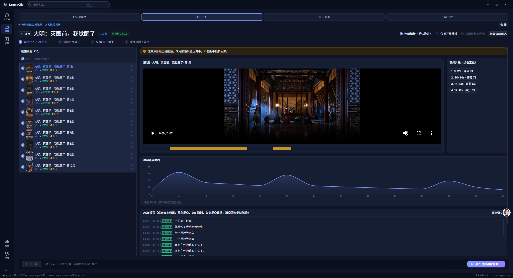
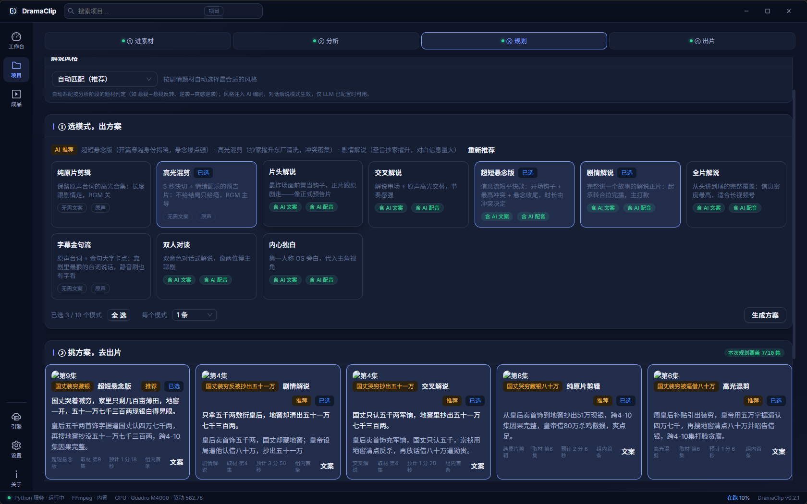
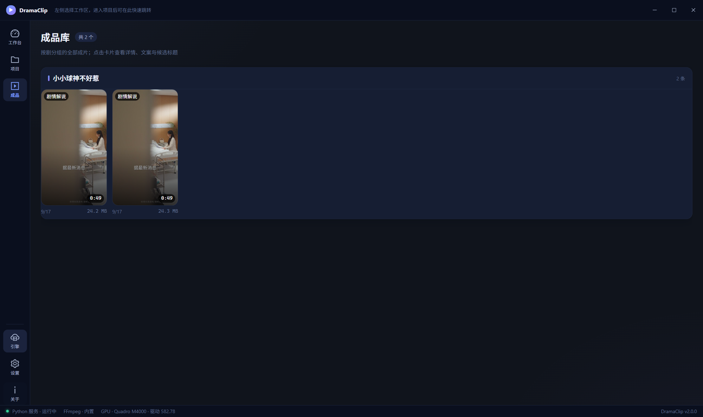
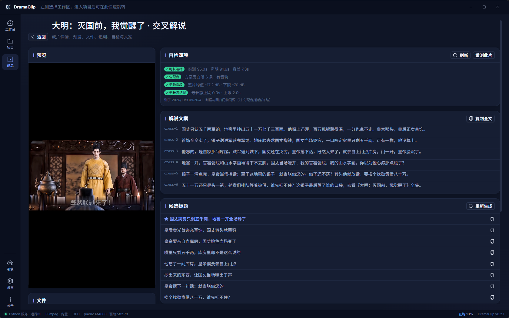
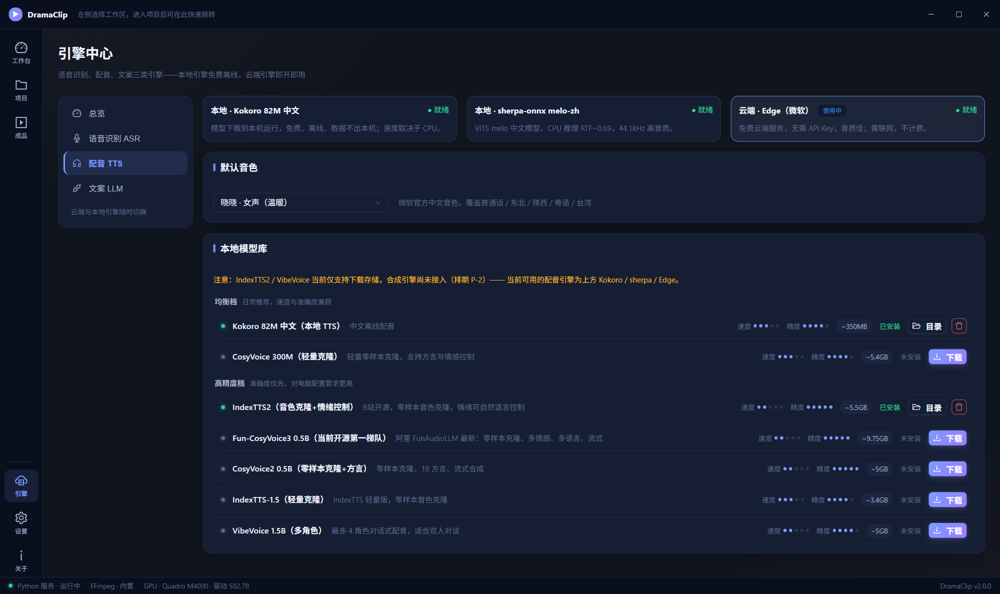

<div align="center">

# 🎬 DramaClip

**一部 80 集短剧丢进来，产出一整面墙能直接发的推广短视频。**

AI 替你把全剧看完、稿写好、角色原声克隆成解说嗓、画面剪口对齐镜头、响度混到发布标准——
媒体处理全部在你这台机器上跑完，素材不出本机，中断了随时接着跑。




</div>

---

## 📲 关注公众号

<div align="center">


**扫码关注 · 更新动态 / 使用技巧 / 短剧推广实操**
问题反馈与交流也在公众号进行。

</div>

---

## 🤔 它替你省下什么

| 手工做时的坑 | DramaClip 的做法 |
|---|---|
| 几十集人肉翻，只为找几个高光 | 融合转写 + **跨集编排**：LLM 通读全部已分析集数的转写与冲突峰，跨集串出完整故事线 |
| 解说里全是「角色A」「角色B」，观众记不住谁是谁 | **说话人分离 + 角色真名**：CAM++ 声纹聚类分角色，编剧 LLM 从台词推断真名——文案里是「小明」「姐姐」 |
| 剪口切在动作中间，画面一跳一跳的撕裂感 | **剪口两级吸附**：先对齐台词边界，再外扩到镜头切点——接缝落在换镜头处，看着像一次正常转场 |
| 克隆音色拿原片当参考，BGM 一股脑混进嗓子里 | **参考音频一键人声分离**：MDX-Net 把 BGM/音效剥干净只留人声（实测信噪比 10.7dB → 26.1dB） |
| 切点一刀下去吞了半句话 | **台词保护区避让**：每行台词 `[开始-0.2s, 结束+0.15s]` 是禁区，命中自动外移 |
| 解说一开口，原声和人声互相盖 | **语音避让混音**：解说段原声压至 10%、全程衬底 8%，`amix` 关归一化 + 限幅器收口 |
| 响度忽大忽小，平台还要再压一遍 | 整片按 **EBU R128 归一到默认 −14 LUFS**，真峰值同趟复核 |
| 解说文案一股模板概述腔 | **编剧双层指令**：基本功层常驻（3 秒钩子、半句钩切、最大反转不剧透）+ 题材口味层自选 |
| 出一版就得守着进度条 | 任务队列 + **段级断点续跑**：中断后重跑只补没编完的段 |
| 软件一关，选过的集全白挑 | 项目 / 剧集 / 分析 / 方案 / 出片记录全落本地 SQLite，**随时中断随时恢复** |

## 🚶 一部片子的四阶段

界面顶部的阶段条就是这四步，只读、不替你操作；哪一步卡住，它会用一句话写明缺什么。

| 阶段 | 机器在做什么 | 你在做什么 |
|---|---|---|
| ① **进素材** | 扫描目录、按集登记、探测时长与分辨率 | 选目录、勾选要处理的集 |
| ② **分析** | 停顿切分 + ASR 转写 + OCR 硬字幕融合 + LLM 断句校对、画面理解（视觉轨）、场景切割与冲突峰打分 | 等，可以边等边翻逐集转写与画面轨 |
| ③ **规划** | LLM 跨集编排方案：每个模式产出多条角度互异的卖点方案 | 逐条读文案，选中或重掷 |
| ④ **出片** | 段级切割 → 拼接 → 字幕烧录 → 混音归一 → 响度复核 | 点开始，看队列，收片 |

## 🔬 流程详解：分析 → 规划 → 成品

### ① 分析：把剧听懂、看懂

**全剧一次（阶段 A）**

- **OCR 硬字幕抽取**：RapidOCR 定位字幕带并逐行识别；结果按素材变更标识 + OCR
  引擎代际缓存——引擎升级不会吃到旧产物
- **热词挖掘 + 人工热词**：jieba 统计全剧字幕条（中文 2–4 字、频次 ≥3、滤虚词）取
  前 10；你在设置里点名的专名（`asr.hotwords_extra`，顿号/逗号/空格分隔皆可）永远
  排在热词表最前——挖掘表是 OCR 派生的，会漏生僻人名、也会把错字当热词

**逐集（阶段 B）**

1. **停顿切分**：能量谷找句间停顿，先切片段再转写——跨停顿并句、句尾串音物理消失
2. **ASR 转写**：paraformer 逐段转写（字级时间戳、热词注入）；可切换 Whisper 或云端引擎
3. **说话人分离**：CAM++ 声纹聚类自动分角色（可指定人数）
4. **场景检测 + 冲突评分与高光**：LLM 逐场景打分，高光窗口带时间窗、分数与理由
5. **画面理解轨**（可选）：Qwen3-VL 逐集 16 帧，产出带时间戳的画面实据

**转写精炼（每集一次 LLM 调用）**

连续字流 + 字幕窗参考 + 热词表一起喂给 LLM：语义断句、同音纠错、**每句强制完整
标点**（字幕行常无标点且分行碎，明令不模仿它的风格）。输出逐字对回原字流过**护栏**：
丢字还原、非近音回退、无据插入丢弃——LLM 的自由度被数学约束。时间映射按字幕窗
锚定或字流实测，说话人句内同源才认领。

**降级纪律**：LLM 不可用回退融合分段，OCR 缺失转纯 ASR 降级版并在日志明示——
所有降级都留痕，不静默。

### ② 规划：讲什么、怎么讲

**角度选题（每模式一次 LLM 调用）**：产出 K 条卖点互异的取材角度——角度名、成立
理由、开场钩子首句、**叙事母题（十二选一）**、取材集。喂给选题模型的不止台词摘录，
还有**每集档案**（冲突高峰与高光按评分取前 5，带时间窗与理由）：母题关键拍落在
哪些集，看密度地图定，不凭猜。

**十二张叙事母题卡**：先扬后揭 / 蓄力爆发 / 顺叙反转 / 爆点回环 / 复仇清算 /
马甲揭晓 / 逼近死线 / 情感亏欠 / 层层揭皮 / 重生先知 / 假戏成真 / 追悔莫及。
每张带「开场/中段/结尾」三段结构指令随角度注入成稿——剧情解说的剧本链按结构卡
自选画面锚点（先扬后揭的画面顺序在这里真正落地），规则链保持时间序、文案层响应
母题。K 条方案轮换不同母题，模板感自然散开。

**闸门**：成稿前，同模式同取材集的两条角度直接拒绝；成稿后，与已接受方案的重叠率
超过 60% 拒绝——「K 条其实是同一部片切 K 次」被两道闸拦在库里。

**成稿两族**：

- *规则编排族*（交叉/片头/超短/全片/纯原片/高光/金句流/双人对谈/独白）：按冲突分
  取景、时间序铺时间轴，逐槽文案单次 LLM 调用（槽位职责 + 区间台词 + 母题结构卡）
- *剧本驱动族*（剧情解说）：LLM 写全稿（每段带集号与时间锚点）→ 清洗（丢段数如实
  落账）→ 台词边界吸附 + 镜头切点外扩装配

**复述质检 + 重写循环**：无上下文观众「闭卷复述」度量可懂度（结论进 trace）；
不达标则带卡点重写一轮，**重写稿复述达标才换血，否则保原稿**——重写有成本，
不靠新鲜感换血。

### ③ 成品：合成与渲染

- **配音**：引擎池多路（edge-tts / IndexTTS2 本地角色原声克隆 / 云端 cosyvoice、
  qwen-tts）；实测时长回填时间轴；段级缓存（同文本+引擎+音色直接命中）；音色
  串行防互踩
- **渲染**：解说字幕按预设样式烧制；源硬字幕 delogo 逐行擦除（行级时间窗，没字的
  画面不糊补丁）；源音避让混音；两遍 loudnorm 收口 EBU R128（默认 −14 LUFS）；
  9:16 与转场；成品像素级自检——漂了不出片
- **交付**：成片按剧落盘、进度逐段上报、失败重试；发布物料（标题六句式/发布文案/
  标签组）一键复制

## ✨ 功能特性

- 👁️ **画面理解（视觉轨）**：本地 Qwen3-VL 三档（2B/4B/8B，GGUF 量化 + llama.cpp 运行时，CPU 可跑）——每集均匀采 16 帧，LLM 逐窗描述产出带时间戳的画面实据；编剧提示词按集附【画面轨】，文画咬合有据可查；剧集详情画面轨卡逐帧可点跳播。
- ✨ **转写精炼层（LLM 断句 + 语境校对）**：字幕窗（画面事实）与 ASR 字流一起喂给 LLM——断句与字幕节奏自然锚定，同音错字语境修正（传承→穿成、东昌→东厂）；**每句强制完整标点**（独白/旁白不再裸奔）；对齐审计护栏自动修复非法编辑（丢字还原/改写回退/无据插入丢弃），LLM 的自由度被数学约束。
- 🔥 **人工热词兜底**：设置里点名的专名永远排在热词表最前——自动挖掘的表会漏生僻人名、也会把错字当热词；四种分隔符皆收，OCR 关闭照常生效。
- 🎞️ **叙事母题库（十二卡）**：先扬后揭 / 蓄力爆发 / 顺叙反转 / 爆点回环 / 复仇清算 / 马甲揭晓 / 逼近死线 / 情感亏欠 / 层层揭皮 / 重生先知 / 假戏成真 / 追悔莫及——选题时按角度定母题，三段结构卡随角度注入成稿，方案卡显示母题标签；K 条方案轮换不同讲法，模板感自然散开。
- 🔁 **复述质检 + 重写循环**：无上下文观众「闭卷复述」度量文案可懂度；不达标带卡点重写一轮，重写稿复述达标才换血，否则保原稿——重写有成本，不靠新鲜感换血。
- 🎭 **十种出片模式，先出方案再出片**：所选模式一次并行编排，逐条过目后才渲染——一部剧一次出一面墙，而不是一版碰运气。
- 🗑️ **源硬字幕智能擦除**：OCR 逐行检测原字幕 → delogo 逐行涂抹擦除，解说字幕压进擦净的带内——双字幕叠影根治，花字/道具字不误伤
- 🧠 **OCR × ASR 融合转写**：短剧自带硬字幕，就是片方花钱人工校对过的金标准。OCR 主通道与 ASR 逐段对齐投票，一致采用、分歧按置信度裁决、双低置信标记人工复核（详见下文专节）。
- 📄 **同名 `.srt` 优先**：你手工校对过的同名字幕文件会优先于库内转写，用作台词保护区边界——尊重手工金标准，不逼软件重认一遍。
- 🌐 **跨集编排**：LLM 拿全部已分析集数的转写与冲突峰取材，串出完整故事线——"废柴一杆清台"式的多集反转弧，而不是第一集的铺垫切片。
- 💬 **金句判定 LLM 提取**：按「传播力」挑金句——排比豪情/情感独白/世间清醒都算，编号回填零编造；失败带原因明示，无静默降级。
- 🎯 **文画咬合双锚定**：台词锚定（取材区间里说了什么，解说第一句就写什么）+ 画面轨锚定（每集 16 帧画面实据随集附给编剧）——文案与画面双重对齐。
- ✍️ **九处 LLM 提示词界面可编辑**：题材分类、冲突打分、风格自选、选题角度、结构指令、解说基本功、逐槽填词、候选标题、方案评分——全在「引擎中心 → 提示词」查看、编辑、一键回默认；覆盖存库、即存即生效，不碰代码。任何 OpenAI 兼容端点即插即用，本地 Ollama / LM Studio 同协议接入。
- 🎙️ **配音音色按引擎独立**：本地 Kokoro **100 个中文音色**（55 女 + 45 男，全量离线免费）、微软 Edge 14 个官方中文音色（普通话/东北/陕西/粤语/台湾）；**音色克隆**（IndexTTS-2.5 / CosyVoice：拿剧集角色原声克隆解说嗓音，参考音频一键人声分离剥掉 BGM）；引擎卡内置**试听**，选定之前先听到成品音。
- 🗣️ **说话人分离（角色聚类）**：paraformer + CAM++ 声纹聚类自动分角色（自动判人数，也支持指定），编剧 LLM 从台词推断真名——解说文案里是「小明/姐姐」而不是「角色A」；剪口两级吸附到台词边界与镜头切点，接缝落在换镜头处，画面不撕裂。
- 🎚️ **影院级混音与响度收口**：语音避让 + 段间近邻衔接消除微跳跃，整片 EBU R128 归一（默认 −14 LUFS），响度直接达到发布标准。
- 🛡️ **台词保护与语音避让**：切点由 AI 决定，落点永远避开台词边界不吞字；人声不被原声盖（详见下文专节）。
- 🔁 **段级断点续跑**：出片中断后重跑，只重编真正需要重编的段。复用判据逐项核对声明输入——源文件身份、时间轴、字幕文本、配音内容、台词保护区；任一项变了就不许用旧段，半成品永远进不了拼接。
- 💻 **本机运行条件检测 + 诚实回退**：显卡 / 内存 / 磁盘一键探测，逐个模型给出"可运行 / 内存不足 / 磁盘不足"结论；NVIDIA 自动启用 NVENC（p4/hq 档），CUDA 运行库一键下载注入，探测不到就诚实回退 CPU int8，全引擎无显卡照跑。
- 📥 **本地模型导入向导**：手上已有权重目录或文件？四步完成识别与体检，缺哪个文件、校验为什么不过当场说明，不靠猜路径。
- 💾 **全流程状态持久化**：随时中断随时恢复；成片按剧分组、9:16 海报墙管理，详情页逐段文案可复制、LLM 候选标题一键采用。
- 🔒 **数据不出本机**：转写、场景、配音、编码全部本地执行；LLM 是唯一可选的外部依赖，切到本地端点即可完全离线。

## 🎭 十种出片模式

| 模式 | 一句话 |
|---|---|
| 📖 **剧情解说** | 完整讲一个故事的解说正片：起承转合拉完播，主打款 |
| 🔀 **交叉解说** | 解说串场 + 原声高光交替，节奏感强 |
| 🎬 **片头解说** | 最炸场面前置当钩子，正片跟原剧走——像正式预告片 |
| ⚡ **超短钩子** | 信息流短平快款：开场钩子 + 最高冲突 + 悬念收尾，时长由冲突决定 |
| 📢 **全片解说** | 从头讲到尾的完整覆盖：信息密度最高，适合长视频号 |
| 🎙️ **双人对谈** | 双音色对话式解说，像两位博主聊剧 |
| 💭 **内心独白** | 第一人称 OS 旁白，代入主角视角 |
| ✂️ **纯原片剪辑** | 保留原声台词的高光合集：长度跟剧情走，BGM 关 |
| 🎆 **高光混剪** | 全剧高能场景 5 秒快切 + 情绪配乐的预告片：不给结局只给瘾 |
| 📝 **字幕金句流** | 原声台词 + 金句大字卡点：靠剧里最狠的台词说话，静音刷也有字看 |

> 除「纯原片剪辑」「高光混剪」「字幕金句流」外，其余七个模式的文案由编剧模型产出——**没配 LLM 时这七条会逐条失败并在队列里写明原因**，不会拿规则拼一版糊弄你。

## 🧠 OCR × ASR 融合转写（三代目）

单一 ASR 在短剧场景有硬伤：BGM 盖词、同音错字、句界并串。而短剧画面自带**逐句硬字幕**——DramaClip 把两条通道按实测强弱分工：

1. **停顿切分先行**：能量检测找句间停顿（平稳底噪上的能量谷），按停顿先把音频切成短语级片段再转写——跨停顿并句、句尾串音物理消失，时间戳以真实切分点为锚；
2. **文本归 ASR、时间与分行归字幕**：真机 207 字人工标注实证（ASR 独对率是字幕的 2 倍、字幕抄写 CER 41%）——ASR 出文本（同音错保词形），字幕窗出时间与分行；
3. **LLM 断句 + 语境校对**：字幕窗与 ASR 字流一起喂给 LLM 断句修同音错字，对齐审计护栏自动修复非法编辑（丢字还原/改写回退/无据插入丢弃）；
4. **热词反哺**：画面内文字（人名/地名/专有名词）自动提炼为 ASR 热词，后续集数识别更准；
5. **繁简归一**：全链路输出统一简体。

真机实测：转写行与字幕在屏节奏一致，「传承/诸传/东昌」式同音错字被语境修正。

## 🛡️ 台词保护与语音避让

剪辑最容易翻车的两处，是**切点吞字**和**人声被原声盖住**，这两处都有硬规则：

1. **台词保护区避让（Smart Jitter）**
   - **禁止盲切**：切点由 AI 选题决定，但落点永远不吞字。
   - **保护区**：以台词边界为基准，每行 `[开始 - 0.2s, 结束 + 0.15s]` 标为禁区——同名 `.srt` 在时以它为准，否则用库内融合转写结果。
   - **智能避让**：入点命中禁区自动外移；落在安静空白间隙则允许 `≤ 0.3s` 的安全随机抖动。
2. **语音避让**：解说轨出现时，原声作为衬底自动压低（解说段 `volume=0.1`、全程衬底段 `volume=0.08`），`amix` 关闭归一化并经限幅器收口，确保人声清晰不被原声淹没。

每个片段另外施加一组**幅度极小的常规处理**——变速、缩放、色彩、元数据，都是剪辑软件的日常动作，与剧情内容无关：

- **极微变速（Micro-Speed）**：`0.996 ~ 1.004` 随机，FFmpeg `atempo` 变速不变调，不损伤音质与连续性。
- **微缩放（Micro-Scaling）**：随机缩小 `0.982 ~ 0.988` 后等比拉回原输出尺寸（如 1080×1920），无黑边、无分辨率偏差。
- **色彩微幅波动（Visual eq）**：对比度 `0.99 ~ 1.01`、亮度 `±0.01`，肉眼不可辨。
- **元数据不写入**：分段与拼接全程注入 `-map_metadata -1`，成片不携带设备、时间与地理元数据。

数值区间取自 `docs/06-经验参数表.md` §1；这四项在编码阶段逐片段固定施加，界面当前不提供开关。

## 🔬 质量优先：宁可不出片，也不交次品

这不是口号，是逐条写进裁决表的规则——**凡是会改变你所见所听的"降级路径"，一律改成失败**：文案空、配音缺、响度不过门、时间轴对不上源片，该条方案直接标失败并在队列页给出错误原文与「重掷此条」入口，而不是一版能跑但不行的片子。（逐条裁决见 `docs/superpowers/specs/2026-09-10-dramaclip-ui-redesign-design.md` §3.3.1）

配套的三件事：

- **三态读数**：任何质量读数只有 `达标 / 不达标 / 未知` 三种结论。取不到数就写"未知"，绝不用默认值倒推一个绿灯——界面上的阶段灯同样「宁灰勿假绿」。
- **真机回归门禁**：`scripts/verify_modes.py` 把十种模式各跑一部真剧，逐条核对响度 LUFS、真峰值、语音避让深度、源片段对齐、时长对账、配音覆盖率——不是单测里的假 ffmpeg。
- **代码与文案双门禁**：ESLint（strict 型约束 + 单文件 300 行红线）、`tsc --noEmit`、Vitest；ruff + mypy strict + pytest。另有一道**文案真值扫描**，同时盯着界面文案与本 README：没实现的能力不许写，合规红线词不许写，免责声明原文不许删。

## 🛠️ 技术栈

### 桌面端
- **Electron 44** - 跨平台桌面框架（无边框窗口 + 自定义标题栏）
- **React 19 + TypeScript 5.9（strict）** - UI 与类型安全
- **Ant Design 6 + Zustand 5** - 组件库与状态管理
- **Vite 8 + Vitest 5** - 构建与测试

### 服务端
- **Python 3.12+** - 本地服务（包名 `dramaclip`）
- **JSON-RPC 2.0 over 环回 TCP + NDJSON** - 进程间通信（token 握手 + 心跳自动重启）
- **SQLite（WAL）** - 全部业务状态唯一存储，服务独占写入
- **PyInstaller** - 打包为随应用分发的 sidecar

### AI / ML
- **paraformer-large（funasr）** - 中文转写主通道：停顿切分先于转写，字级时间戳
- **Qwen3-VL（GGUF 量化 + llama.cpp 运行时）** - 画面理解三档（2B/4B/8B，CPU 可跑）
- **RapidOCR** - 硬字幕识别主通道
- **PySceneDetect + librosa** - 场景切割与音频能量/节奏分析
- **jieba** - 台词分词与画面热词提炼
- **Kokoro / edge-tts / IndexTTS-2.5 / CosyVoice** - 本地与云端多路配音；百炼 DashScope 适配器（ASR/TTS 云端引擎底层就绪）
- **OpenAI 兼容 LLM** - 编剧、语义与转写精炼层（云端或本地端点，凭据在界面配置）

### 媒体管线
- **FFmpeg 8.1.1（随包内置，免安装）** - 滤镜链编排、ASS 字幕烧录、libx264 / NVENC 编码
- **EBU R128 loudnorm** - 成片响度归一与真峰值复核

## 🖼️ 界面一览

| 分析工作台（转写 / 冲突曲线 / 逐句校正） | 出片中心（十种模式 · 方案卡） |
|---|---|
|  |  |

| 成品库（按剧分组海报墙） | 成片详情（自检四项 · 解说文案 · 候选标题） |
|---|---|
|  |  |

<details>
<summary>更多界面：引擎中心 · 模型资产 · GPU 状态</summary>



</details>

## 📦 安装

### 前置要求

- Windows 10/11
- Node.js 24+
- Python 3.12+ 与 [uv](https://docs.astral.sh/uv/)（管理 `service/.venv`，依赖真相源）
- FFmpeg **无需安装**（已随包内置 `resources/ffmpeg/`）
- NVIDIA 显卡可选——无显卡全流程照跑

### 安装步骤

```bash
# 1. 克隆仓库
git clone https://github.com/efarsoft/DramaClip.git
cd DramaClip

# 2. 前端依赖
npm install

# 3. Python 环境（service/.venv，含全部可选依赖组；桌面端 dev 启动优先解析它）
cd service
uv sync --all-extras
cd ..

# 4. 一键启动开发栈（Vite + Electron + Python 服务）
npm run dev
```

首次启动按主区**首启三步**清单走（装 ASR 模型 → 配文案 LLM → 新增项目），每步带完成状态与直达入口，右栏「环境就绪度」同步显示全局状态：

1. **装一个 ASR 模型**：推荐 Whisper Small（~480MB），装完才能分析
2. **配文案 LLM**：填一个 OpenAI 兼容端点（跳过也能先用纯原片剪辑）
3. **新增项目**：选素材所在文件夹，文件夹名就是剧名

## 🚀 使用

### 开发模式

```bash
npm run dev     # 一键完整开发栈：Vite 热更新 + Electron + Python 源码直跑
```

> 渲染层改动即时热更新；**主进程（desktop/main/）改动必须整栈重启**，仅 HMR 会半新半旧。

### 生产构建

```bash
npm run dist:service              # PyInstaller sidecar → resources/dramaclip-service/（含 ML 依赖，约 1GB）
node scripts/verify_sidecar.mjs   # sidecar 冒烟：握手/资源注入/预设/优雅退出
npm run dist                      # electron-builder → NSIS 安装包 + zip（desktop/release/）
```

### 运行测试

```bash
npm run lint                      # 前端门禁一：ESLint（strict 型约束 + 300 行/60 行红线）
npm run typecheck                 # 前端门禁二：tsc --noEmit
npm test                          # 前端门禁三：Vitest（含文案真值与样式契约扫描）

cd service
uv run ruff check dramaclip/      # Python 门禁一
uv run mypy dramaclip/            # Python 门禁二（strict）
uv run pytest tests/              # Python 门禁三
```

## ⚙️ 配置体系

DramaClip 采用**三层设置架构**，全部经界面即改即存，无需手改配置文件：

1. **全局偏好（SQLite `settings` 表）**：「偏好设置」页可视化管理——出片参数、转写阈值、下载镜像等；Python 服务独占写入，界面保存立即生效。
2. **引擎多实例（`engine_configs` 表）**：「引擎中心」按能力域（ASR/TTS/LLM）管理本地模型与云端配置，同域多实例、单启用，切换零重启。
3. **项目级覆盖（`projects.settings`）**：单部剧可覆盖方案数 K、转写档位、解说风格等，粒度精确到剧。

LLM 凭据在「引擎中心 → 文案 LLM」配置，支持任意 OpenAI 兼容端点（DashScope / Agnes / 本地 Ollama / LM Studio），多配置一键切换；编剧提示词本身在同页的「提示词」tab 里编辑。

## 📁 项目结构

```
DramaClip/
├── desktop/                 # Electron + React 桌面应用
│   ├── main/               #   主进程薄壳（窗口/IPC/服务管理/媒体协议）
│   └── src/                #   渲染层（features 按业务域自含）
├── service/                 # Python 本地服务（包名 dramaclip）
│   └── dramaclip/
│       ├── api/            #   RPC 方法注册层
│       ├── engines/        #   业务引擎（分析/语义/解说/字幕/剪辑处理/TTS/编码）
│       └── infra/          #   基础设施（SQLite/ffmpeg/模型管理/GPU/配置）
├── protocol/                # 三端契约唯一真相源（JSON Schema + TS 类型）
├── resources/               # 随应用分发的只读资源（ffmpeg/字体/字幕预设）
├── scripts/                 # 开发编排与验证脚本（含真机九模式门禁）
└── docs/                    # 架构决策、设计系统、协议规范、质量报告
```

## 📝 开发指南

### 代码门禁

- **TypeScript**：strict + `noUncheckedIndexedAccess`，禁 `any`，单文件 ≤800 行 / 单函数 ≤120 行
- **Python**：ruff + mypy strict，注解 100%
- **契约**：`protocol/` 唯一定义，schema 与 TS 两侧同步
- **文档入口**：`docs/02-总体架构与文档地图.md`（架构决策、协议规范、各层设计都在那儿点名）

### 提交规范

使用语义化提交信息：

```
feat: 新功能        fix: 修复 bug       docs: 文档更新
refactor: 重构      test: 测试相关      chore: 构建/工具相关
```

## 📄 声明

素材授权责任由使用者承担；本软件不代为取得或证明素材授权，亦不提供规避原创性检测的功能。媒体处理全部在本机完成，素材不上传。

成片含 AI 合成语音与 AI 生成文案。是否在成片上标注「AI 生成」由使用者自行决定：「设置 → 出片 → AI 生成标注」开关默认关闭，开启后成片右上角自动烧制「AI 生成」字样；发布到具体平台时，请按当地法规与平台规则自行标注 AI 生成内容。
